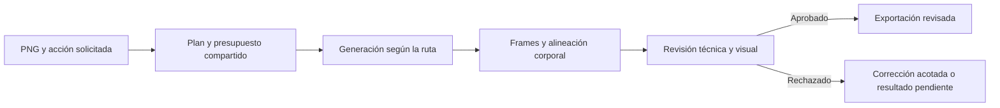

# Tower Sprite Pipeline

**De un PNG de personaje a una animación direccional revisada.**

> **Experimental / alpha.** Copia pública del código bajo licencia MIT. La generación externa puede producir resultados defectuosos que deben rechazarse o corregirse.

[English](README.md) · [Instalación](docs/INSTALL.md) · [Estado](docs/STATUS.md) · [Roadmap](ROADMAP.md) · [Cómo contribuir](CONTRIBUTING.md) · [MIT](LICENSE)

## Para qué sirve

El proyecto busca resolver una dificultad concreta: generar frames no basta para obtener una animación utilizable. También hay que conservar la identidad, la anatomía, la escala del cuerpo y las armas, el agarre del equipo, la transparencia, la dirección y la continuidad del movimiento.

Es una skill de Codex acompañada de herramientas Python y JavaScript. Coordina generación externa y procesamiento local; no es un modelo de video entrenado por este proyecto.

Es un esquema conceptual; el contrato de cada ruta define sus pasos concretos.

La interacción que buscamos es sencilla:

> Usa este personaje: correr hacia la izquierda, ocho frames de 100 ms.

El agente selecciona el flujo documentado, prepara los insumos, registra el presupuesto autorizado, revisa el resultado y exporta después de aprobar las comprobaciones aplicables.

## Objetivo

Conseguir un proceso reproducible y auditable para crear animaciones a partir de personajes diversos, con correcciones acotadas y resultados que puedan inspeccionarse antes de incorporarlos a un juego.

El objetivo incluye mantener fijo el centro horizontal del cuerpo y conservar su rebote vertical natural. Las armas, colas y extremidades móviles no deben determinar ese centro.

No prometemos que cualquier personaje produzca una animación correcta al primer intento.

## Qué contiene el flujo documentado

- Generación de imágenes o video mediante FAL, según la ruta elegida.
- Selección de frames o procesamiento de una hoja de sprites.
- PNG individuales, sprite sheet, GIF de vista previa e información de revisión.
- Alineación horizontal basada en una referencia corporal.
- Presupuesto compartido, recuperación de trabajos conocidos y correcciones limitadas.
- Validación técnica y revisión visual de los archivos reales.
- Rutas nativas específicas cuando se solicitan expresamente, con alcance limitado.

El alcance de acciones contempla caminar, correr, reposo, ataque, impacto, muerte y vuelo. Esa lista no significa que todas las combinaciones de acción, personaje y dirección estén validadas.

## Cómo vamos

Los registros de desarrollo consultados el **26 de octubre de 2026** describen **11 de 12 entregas aprobadas en una prueba concreta de cuatro personajes**. La carrera del gólem permanece pendiente en ese registro.

Ese resultado no es una tasa universal de éxito ni una evaluación independiente. Tampoco demuestra que las entregas históricas ya cumplan todas las políticas incorporadas después.

Se está trabajando en la generalización de las comprobaciones, la alineación corporal entre rutas y una reparación regional de video para el caso restante. El registro consultado todavía no demuestra una entrega final exitosa de esa reparación.

Esta publicación inicial es **experimental / alpha**, con pendientes visibles en el [roadmap](ROADMAP.md) y resultados técnicos en el [informe de validación](docs/VALIDATION.md).

## Principios de calidad

Un canvas del mismo tamaño no demuestra que el personaje conserve su escala. Deben compararse referencias anatómicas estables y el tamaño del equipo.

Centrar la silueta completa puede desplazar el cuerpo cuando se mueve una espada o una cola. La alineación debe usar una referencia corporal y preservar el movimiento vertical.

Una prueba de código aprobada no demuestra que el ataque tenga fuerza o que la carrera alterne correctamente sus apoyos. La revisión visual sigue siendo necesaria.

Una corrección horizontal no repara anatomía defectuosa. Los resultados rechazados deben conservarse como evidencia, sin presentarlos como entregas terminadas.

## Requisitos y costos

La documentación actual utiliza Python compatible con el flujo de Python 3.12 y Pillow, Node.js 22 o posterior para el transporte FAL y FFmpeg externo para video. El agente necesita además las capacidades de inspección de imágenes que requiera cada ruta.

Windows es el entorno documentado. La validación de Linux y macOS está pendiente.

La generación mediante FAL usa la cuenta y el saldo de cada usuario. La clave debe estar en la variable de entorno `FAL_KEY`, nunca en el repositorio, las conversaciones o los reportes públicos.

Los precios pueden cambiar. Una estimación o reserva local no equivale a una factura ni al saldo informado por el proveedor.

La [guía de instalación](docs/INSTALL.md) explica los requisitos y cómo cargar la skill. El [informe de validación](docs/VALIDATION.md) distingue las comprobaciones realizadas de las pendientes.

## Limitaciones conocidas

Pueden fallar la anatomía, los materiales, la unión de las armas, el movimiento y la limpieza de bordes. Las rutas nativas tienen limitaciones propias. Las rutas históricas y experimentales agregan complejidad.

Exportar archivos no demuestra que estén aprobados dentro de Unity, Godot u otro motor. Esa validación es independiente.

Los ejemplos visuales necesitan derechos de redistribución documentados antes de publicarse.

## Cómo puede ayudar la comunidad

Usa [Discussions](https://github.com/brayan-carlo/tower-sprite-pipeline/discussions) para preguntas e ideas, e issues para defectos reproducibles.

Buscamos reportes reproducibles, personajes de evaluación con permiso para compartirlos, criterios de revisión más claros y correcciones pequeñas acompañadas de evidencia.

El [roadmap](ROADMAP.md) distingue preparación de la publicación, correcciones prioritarias y evaluación futura. La [guía de contribución](CONTRIBUTING.md) propone la información necesaria para revisar un aporte.

## Licencia

El código y la documentación original del proyecto se distribuyen con [licencia MIT](LICENSE), copyright 2026 brayan-carlo.

La licencia del código no sustituye las condiciones de los servicios externos ni los derechos sobre imágenes, modelos o dependencias.

Proyecto independiente: no se afirma afiliación ni patrocinio de Codex, OpenAI o FAL.

## Ejemplos y participación

Puedes abrir una [issue](https://github.com/brayan-carlo/tower-sprite-pipeline/issues) o proponer un cambio siguiendo la guía de contribución. La galería visual queda pendiente de ejemplos con permiso de redistribución documentado. Los personajes privados de desarrollo no forman parte de esta publicación.
