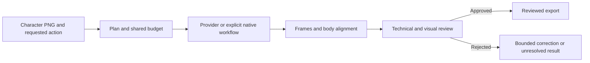

# Tower Sprite Pipeline

**Turn an isolated character PNG into a reviewed directional sprite animation.**

> **Experimental / alpha.** Public source snapshot under MIT. External generation can still fail quality review; this project does not guarantee a successful animation for every character.

[Español](README.es.md) · [Install](docs/INSTALL.md) · [Status](docs/STATUS.md) · [Roadmap](ROADMAP.md) · [Contributing](CONTRIBUTING.md) · [MIT](LICENSE)

## Why this project exists

Generating animation frames is only part of the problem. A useful game animation also needs recognizable anatomy, consistent body and equipment scale, attached weapons, clean transparency, meaningful motion, stable framing, and a coherent loop or one-shot ending.

Tower Sprite Pipeline is a Codex skill with supporting Python and JavaScript tools. Its goal is to make that workflow repeatable and inspectable: from a supplied PNG and a natural-language action request to sprite sheets, individual frames, a preview, and review evidence.

It orchestrates external generation and local processing. It is not a separately trained image or video model.

This is a conceptual overview. The chosen workflow's contract defines the actual steps.

## Intended user experience

Supply one isolated character PNG and describe the action and direction, for example:

> Use this character: run left, eight frames, 100 ms per frame.

The agent resolves the documented workflow, prepares the request, tracks the authorized budget, inspects the result, and exports only after the applicable review passes.

A small input request does not imply that every generated result will succeed. Difficult anatomy, equipment, motion, backgrounds, or provider outputs can still require correction or cause rejection.

## What the documented workflow covers

- Provider-backed image and video generation through FAL, depending on the selected route.
- Video frame selection or sprite-sheet processing.
- Preview GIFs, individual frames, sprite sheets, and quality evidence.
- A body reference for horizontal alignment while preserving natural vertical bounce.
- Shared task budgets, durable job identities, bounded corrections, and recovery of known jobs.
- Technical checks followed by visual review of the actual artifacts.
- Separate, explicitly requested native workflows with limited action and anatomy profiles.

The intended action vocabulary includes walk, run, idle, attack, hit, death, and flight. This describes the project's scope, not verified quality for every action, character, or direction.

## What makes the workflow useful

**Scale is judged on the character.** Equal canvas dimensions do not prove that the body or a weapon stayed the same size.

**The body determines the horizontal center.** A moving sword, spear, tail, or hand must not move the chosen body center. Horizontal alignment must preserve vertical motion.

**A technical pass is not an artistic pass.** The reviewer checks identity, anatomy, scale, framing, transparency, action, and loop continuity.

**Recovery preserves job identity.** An uncertain submission must not be blindly submitted again. A new folder or prompt must not reset the shared task budget.

These are design requirements and documented controls; they are not a guarantee that an external generator cannot produce a defective candidate.

## Current status

Development records reviewed on **26 October 2026** report **11 of 12 approved deliveries in a particular four-character exercise**. The golem run remains unresolved in that record.

This is a finite development exercise, not a general success rate, an independent benchmark, or a guarantee for new characters. The approved historical deliveries also do not establish that every later policy or revision was applied to those older artifacts.

Work in progress includes generalizing quality checks, preserving body alignment across routes, and evaluating a bounded regional video repair for the remaining case. The regional repair has not been demonstrated as a successful final delivery in the records reviewed.

The repository is **experimental / alpha**. Publication checks and their limits are listed in [VALIDATION.md](docs/VALIDATION.md). Cross-platform and game-engine acceptance remain unverified.

## Requirements and costs

The current documentation specifies Python compatible with the Python 3.12 workflow and Pillow, Node.js 22 or newer for the FAL transport, and external FFmpeg for video workflows. The agent also needs the capabilities required by the selected route, including actual image inspection.

Windows is the documented development environment. Linux and macOS validation is pending.

Provider-backed generation requires the user's own FAL account and credit. Store the credential in the environment as `FAL_KEY`; never commit it or paste it into an issue. Prices and model availability may change.

A local reservation or cost estimate is not a provider invoice or an account balance. No universal price per animation is promised.

Start with the [installation guide](docs/INSTALL.md), then run the [documented offline checks](docs/VALIDATION.md). The [publication scope](docs/PUBLICATION.md) explains what was copied, adapted, and omitted.

## Limitations we want to make visible

- Generated anatomy, textures, weapon attachment, and temporal motion can still fail.
- Local alignment does not repair malformed anatomy or an incorrect action.
- Native articulation has a limited supported scope and must not silently replace requested video generation.
- Visual review remains necessary; passing code tests does not prove animation quality.
- Historical contracts and experimental routes add complexity.
- Successful export does not establish Unity, Godot, or another engine's acceptance.
- Examples must have a documented redistribution basis before inclusion.

## Where community help matters

See the [roadmap](ROADMAP.md) for proposed work on reproducible setup, independently supplied characters, scale and motion evaluation, provider-contract robustness, and concise contributor documentation.

Open an [issue](https://github.com/brayan-carlo/tower-sprite-pipeline/issues) for a reproducible failure or proposal, or send a pull request following [CONTRIBUTING.md](CONTRIBUTING.md). Useful contributions include new licensed evaluation cases, focused fixes, and improvements to review criteria. Small, well-described issues are more useful than unsupported claims that an animation is “good” or “bad.”

## License and attribution

The project's code and original documentation are available under the [MIT license](LICENSE), copyright 2026 brayan-carlo.

Dependencies, provider-schema material, model-service terms, and rights to example artwork retain their own terms; see [publication scope](docs/PUBLICATION.md). Publishing the code does not imply redistribution rights for every source image or generated asset.

## Project independence

This is a community project intended to work with Codex and FAL. No affiliation, endorsement, or sponsorship by those services is claimed.

## Visual examples

A public before/after gallery is pending artwork permissions and a reproducible demonstration. We do not redistribute the private development characters as part of this code release.
